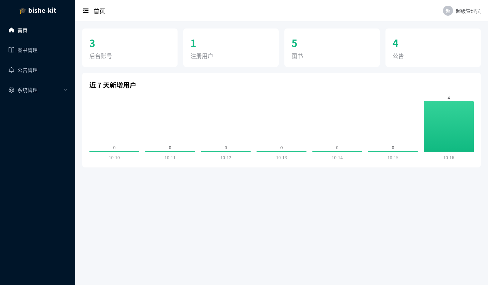
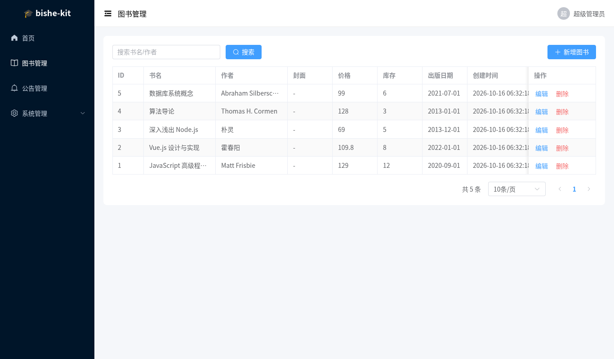
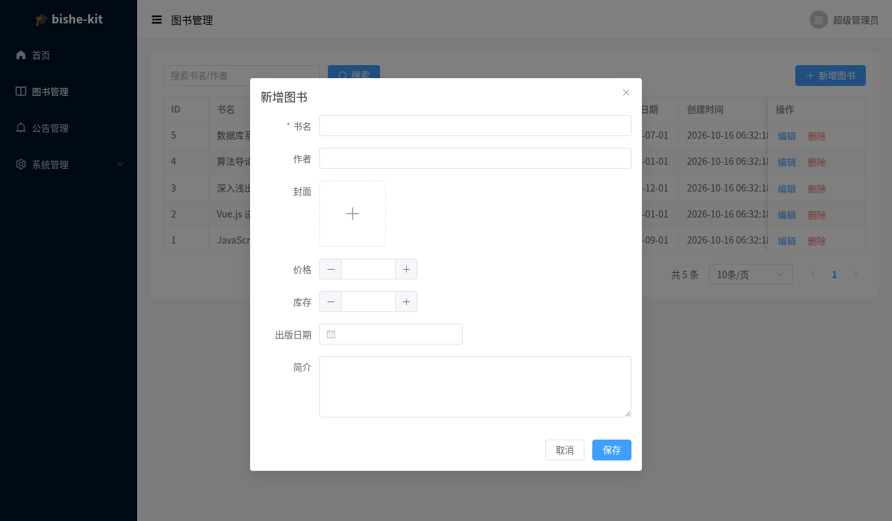
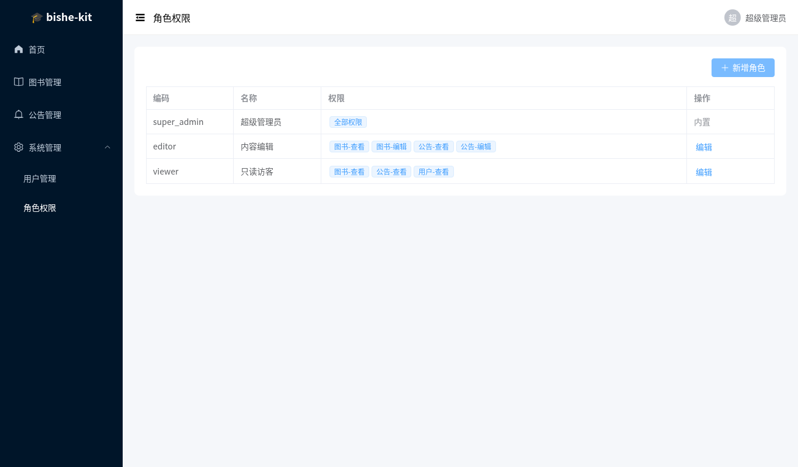
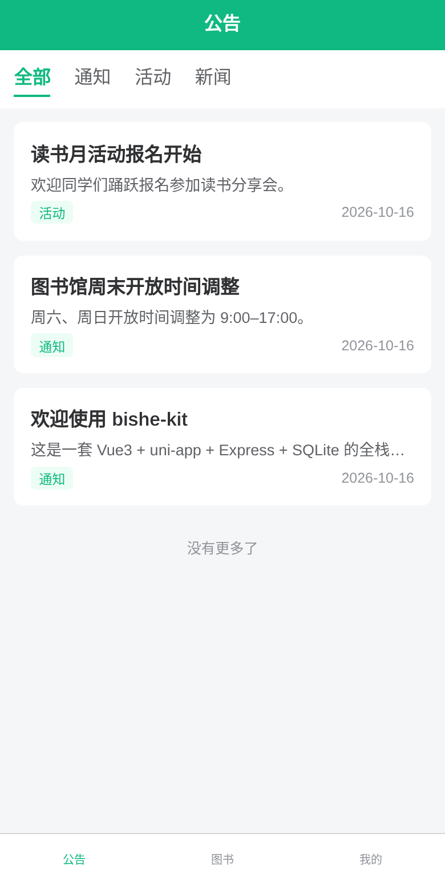
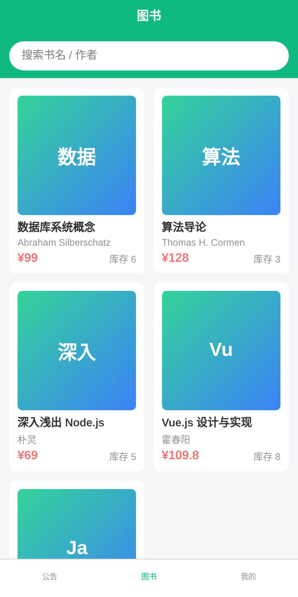
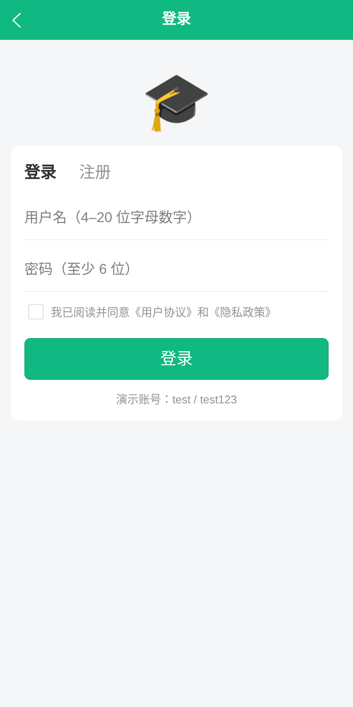

<div align="center">

# 🎓 bishe-kit

**Full-stack starter for graduation projects and small client jobs: Vue 3 admin panel + uni-app client + Express + SQLite**

No database to install: `npm run setup && npm run dev` and it runs. Adding a new business module takes one command.

[中文](./README.md) · **English**

   

</div>

> 📌 **Note**: this project only provides **source code for a starter kit**, for learning and further development. **It does not write theses or do graduation projects for you.** Please follow your school's academic integrity rules.
>
> The UI, demo data and the AI prompt pack are in Chinese (the kit targets Chinese students and freelancers), but the code and API are plain English identifiers.

## Screenshots

| Admin · Dashboard | Admin · Generic CRUD |
| --- | --- |
|  |  |
| **Admin · Auto-generated form** | **Admin · Roles & permissions** |
|  |  |

| Client · Notices | Client · Books | Client · Login |
| --- | --- | --- |
|  |  |  |

## Features

- **Two separate logins (JWT)**: admin accounts (`type=admin`) and client accounts (`type=user`) log in separately and their tokens can't be used on the other side; clients can self-register. Login rate limiting: 5 wrong passwords for the same account from the same IP locks that IP+account for 15 minutes, and 20 wrong passwords from one IP across any accounts also locks it (against credential stuffing). Only the IP is locked, so nobody can lock out someone else's account.
- **RBAC**: roles and permission codes (`book:read`, `book:write`, …) are assigned with checkboxes in the admin panel and apply to both API and menus. Three built-in roles: super admin, editor, read-only viewer. Privilege-escalation protection: a non-super-admin can only grant permissions they have, can't make anyone super admin, and can't edit or delete accounts or roles with more permissions than their own. Self-lockout protection: you can't change your own role or the permissions of your own role. Roles are for admin accounts only; the API refuses to give one to a client account.
- **Generic CRUD**: define an entity in `server/src/entities/*.json`; the backend creates the table, routes and permissions, and the admin panel generates the menu, list, search, pagination and form. The list page has an **Export** button that exports CSV with the current filters (UTF-8 BOM so Excel opens Chinese text correctly; text starting with `=`, `+`, `-` or `@` gets a leading quote so Excel won't run it as a formula).
- **CRUD generator**: `npm run gen` creates a new module in one command; add `--client` to also generate uni-app list and detail pages.
- **File upload**: image upload (type check, 5 MB limit). Image fields in admin forms become upload widgets; clients can change their avatar.
- **Zero-config database**: SQLite via sql.js (WebAssembly). **No MySQL, no native modules to compile**, works on Windows out of the box. Demo data is seeded on first start.
- **uni-app client**: builds for H5 and WeChat Mini Program. Includes a request wrapper (unified error toasts, redirect to login on 401), Pinia, login guard, pull-to-refresh and infinite scroll.
- **API tests**: login/auth, RBAC, escalation and self-lockout protection, CRUD, upload, login rate limiting and CSV export, 13 test cases in total, run by GitHub Actions on Node 20/22. CI also builds the admin panel and the uni-app H5 client, and smoke-tests the CRUD generator with a sample module.
- **AI prompt pack** (Chinese): [docs/prompts](docs/prompts), so Cursor / Claude Code / Trae extend the project following its conventions.
- **Docker (optional)**: one image serves the API, the admin panel and the H5 client.

## Quick start

Requires **Node.js 20.13 or newer** (check with `node -v`).

```bash
git clone https://github.com/MsNan/bishe-kit.git
cd bishe-kit
npm run setup     # install dependencies for all three parts
npm run dev       # start backend, admin panel and client together
```

| URL | What | Demo accounts |
| --- | --- | --- |
| http://localhost:5173 | Admin panel | `admin / admin123` (super admin) · `editor / editor123` (editor) · `viewer / viewer123` (read-only) |
| http://localhost:5174 | uni-app client (H5) | `test / test123`, or register your own |
| http://localhost:3000/api/health | Backend API | — |

WeChat Mini Program: run `npm --prefix client run dev:mp-weixin` and import `client/dist/dev/mp-weixin` in WeChat DevTools. For development, set `VITE_API_BASE` to `http://localhost:3000` in `client/.env` and tick "Do not verify valid domain names" in DevTools.

## Add a business module

```bash
npm run gen -- product 商品 \
  name:string:名称:required:search \
  price:number:价格 \
  cover:image:图片 \
  category:select:分类:options=数码\|服装 \
  intro:text:简介 \
  --icon Goods --client
```

The second argument and the third part of each field are display labels (any language). This will:

1. Create `server/src/entities/product.json`. After a backend restart the table is created, along with `/api/admin/product` CRUD routes and the `product:read` / `product:write` permissions.
2. Add a "商品管理" (product management) item to the admin sidebar, with list, search, pagination, form and image upload generated.
3. With `--client`, also create `client/src/pages/product/list.vue` and `detail.vue`, register them in `pages.json`, and expose the public API `/api/product`.

Field types: `string` `text` `number` `int` `bool` `date` `image` `select`. Modifiers: `required`, `search` (included in keyword search), `options=a|b` (select options).

## Project structure

```
bishe-kit/
├── server/               # Express + SQLite
│   ├── src/
│   │   ├── entities/     # entity definitions (written by the generator)
│   │   ├── routes/       # auth / system (users, roles) / crud (generic CRUD)
│   │   ├── auth.js       # JWT and RBAC middleware
│   │   ├── login-limiter.js # login rate limiting (in memory)
│   │   ├── db.js         # SQLite wrapper
│   │   └── seed.js       # demo data
│   └── test/             # API tests
├── admin/                # Vue 3 + Vite + Element Plus + Pinia
├── client/               # uni-app (Vue 3): H5 / WeChat Mini Program
├── scripts/              # dev.js starts everything, gen-crud.js generator
└── docs/prompts/         # AI prompt pack
```

## API overview

| Method | Path | Description |
| --- | --- | --- |
| POST | `/api/auth/admin/login` | Admin login |
| POST | `/api/auth/login` · `/api/auth/register` | Client login and registration |
| GET / PUT | `/api/auth/me` | Current user info, update profile |
| PUT | `/api/auth/password` | Change password |
| POST | `/api/upload` | Upload an image (login required, field name `file`) |
| GET | `/api/admin/meta` · `/api/admin/stats` | Admin menus and permissions, dashboard stats |
| CRUD | `/api/admin/system/users` · `/roles` · `/permissions` | User, role and permission management |
| CRUD | `/api/admin/<entity>` | Generic CRUD (needs `<entity>:read` / `<entity>:write`) |
| GET | `/api/admin/<entity>/export?keyword=` | Export CSV with filters (needs `<entity>:read`) |
| GET | `/api/<entity>` · `/api/<entity>/:id` | Public read-only client API (when the entity has `public: true`; entities with a `published` field only return published rows) |

Response format: `{ code: 0, data }`; errors use the matching HTTP status code with `{ code, msg }`.

## Test and build

```bash
npm test           # backend API tests (node:test + supertest, in-memory database)
npm run build      # build the admin panel and the H5 client
```

## Docker deployment (optional)

```bash
docker compose up -d --build
# client http://localhost:3000/   admin http://localhost:3000/admin/
```

Before going live, change `JWT_SECRET` and the demo account passwords.

Other optional environment variables:

| Variable | Default | Description |
| --- | --- | --- |
| `TRUST_PROXY` | unset | Set to `1` behind Nginx or another reverse proxy; otherwise the backend only sees the proxy's IP and everyone shares one rate-limit counter |
| `LOGIN_MAX_FAILS` | `5` | Wrong passwords allowed for one account from one IP; `0` disables rate limiting |
| `LOGIN_MAX_IP_FAILS` | `20` | Wrong passwords allowed from one IP across all accounts |
| `LOGIN_LOCK_MINUTES` | `15` | Counting window and lock duration (minutes) |
| `EXPORT_LIMIT` | `10000` | Max rows per export; above this the user is asked to filter first |

Rate-limit counters live in memory and reset on restart; for multiple instances, switch to shared storage such as Redis.

## Keep building with AI

[docs/prompts](docs/prompts) has 7 prompt sets (in Chinese): understanding the project, adding a module, custom APIs, uni-app pages, statistics, documentation, and troubleshooting. They work well with:

- [vue-uniapp-skills](https://github.com/MsNan/vue-uniapp-skills): Vue 3 + uni-app AI skill pack, installs into Cursor / Claude Code / Trae with one command
- [cn-dev-mcp](https://github.com/MsNan/cn-dev-mcp): offline MCP tools for Chinese developers (public holidays, ID card and phone number validation, pinyin, lunar calendar, administrative regions, component doc lookup)

## Author

**Theo (涛哥)**: front-end developer since 2018, mostly Vue 3, uni-app and Node. Blog: [msnan.github.io](https://msnan.github.io).

## License

[MIT](./LICENSE)
