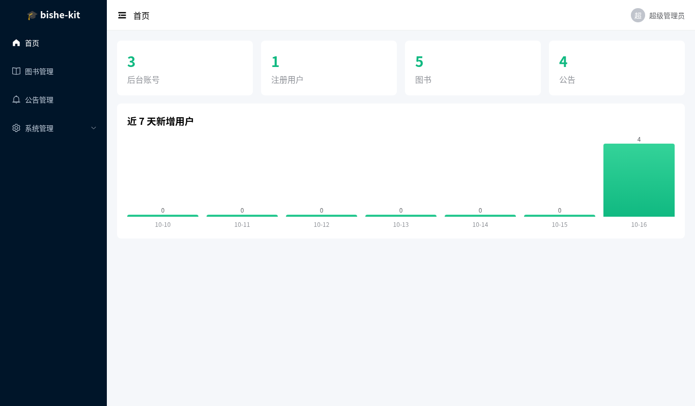
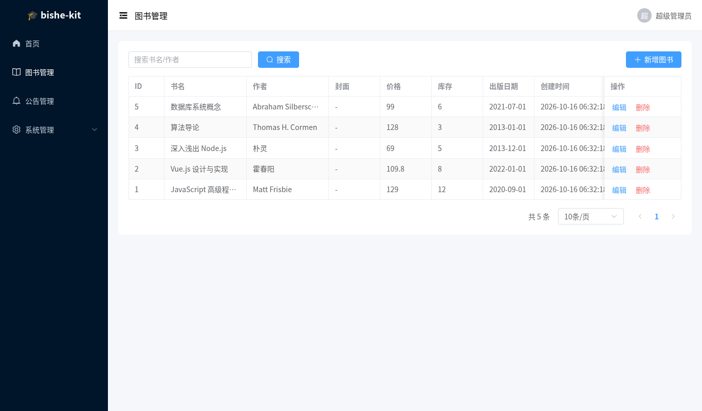
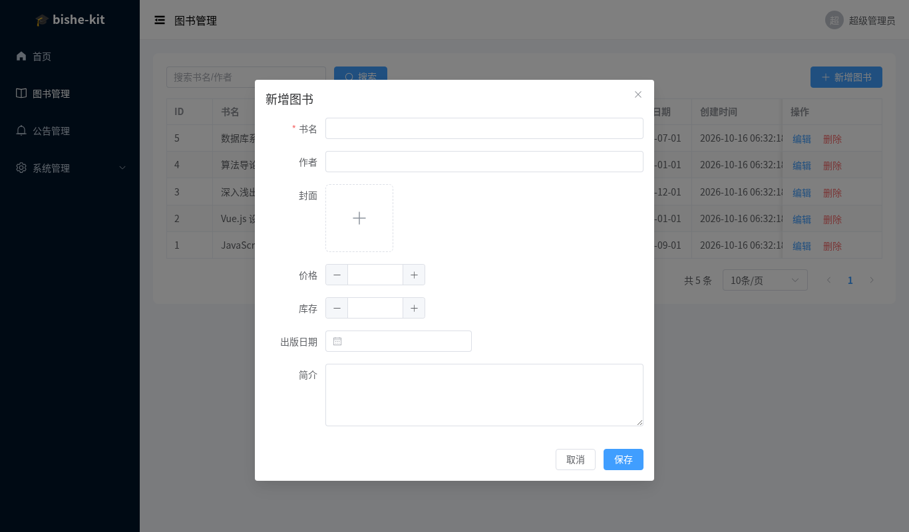
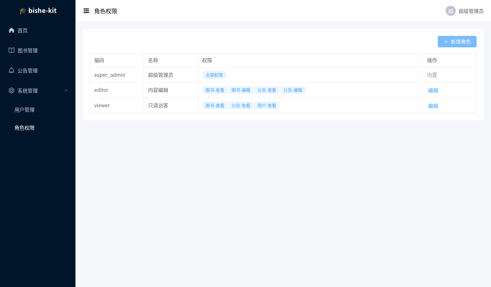
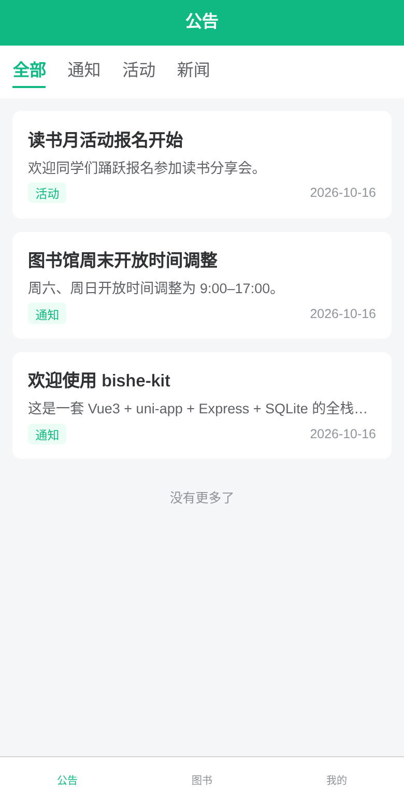
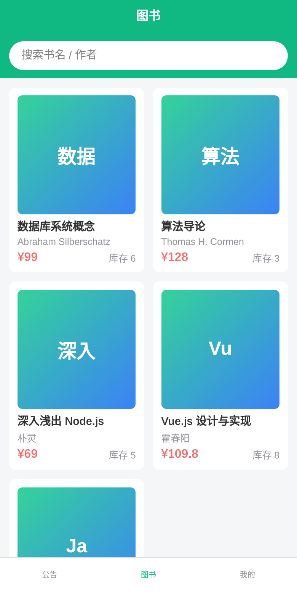
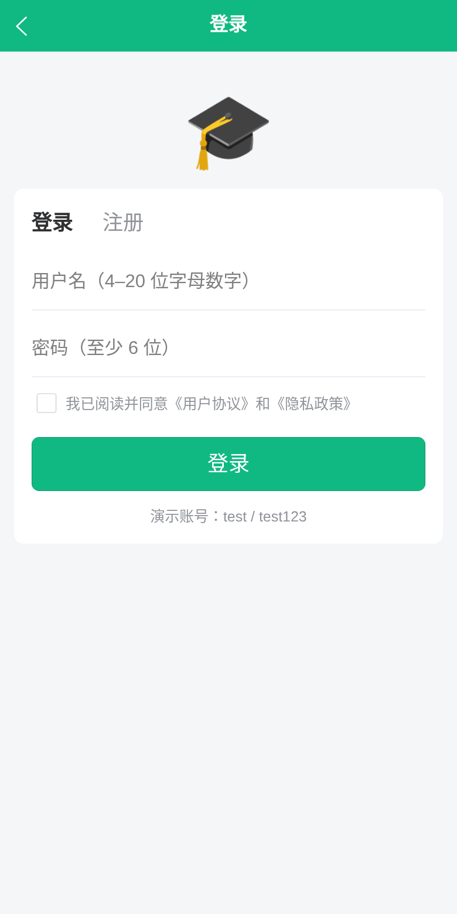

<div align="center">

# 🎓 bishe-kit

**毕设 / 接单全栈脚手架：Vue3 管理后台 + uni-app 用户端 + Express + SQLite**

不用装数据库，`npm run setup && npm run dev` 两条命令就能跑起来；新增一个业务模块只要一条命令。

   

</div>

> 📌 **说明**：本项目只提供**源码脚手架**，用于学习和二次开发。**不代写论文，不代做毕设。** 请遵守所在学校的学术规范。

## 截图

| 管理后台 · 首页 | 管理后台 · 通用增删改查 |
| --- | --- |
|  |  |
| **管理后台 · 自动生成的表单** | **管理后台 · 角色权限** |
|  |  |

| 用户端 · 公告 | 用户端 · 图书 | 用户端 · 登录 |
| --- | --- | --- |
|  |  |  |

## 功能

- **双端登录（JWT）**：后台账号（`type=admin`）和用户端账号（`type=user`）分开登录、互相不能串用；用户端支持注册
- **RBAC 权限**：角色和权限码（`book:read`、`book:write`……）可以在后台勾选分配，接口和菜单同时生效；内置超级管理员、内容编辑、只读访客三个角色
- **通用 CRUD**：在 `server/src/entities/*.json` 里定义实体，后端自动建表、生成接口和权限，后台自动出菜单、列表、搜索、分页和表单
- **CRUD 生成器**：`npm run gen` 一条命令生成新模块，加上 `--client` 还会生成 uni-app 列表页和详情页
- **文件上传**：图片上传（限制类型和 5MB 大小），后台表单里的图片字段自动变成上传组件，用户端可以换头像
- **零配置数据库**：SQLite（sql.js / WebAssembly 版），**不用装 MySQL，也不用编译原生模块**，Windows 也能直接跑；首次启动自动写入演示数据
- **uni-app 用户端**：H5、微信小程序都能编译；包含请求封装（统一报错、401 跳转登录）、Pinia、登录拦截、下拉刷新和触底分页
- **API 测试**：覆盖登录认证、RBAC、CRUD、上传，一共 4 组用例
- **AI 提示词包**：[docs/prompts](docs/prompts)，让 Cursor / Claude Code / Trae 按项目规范扩展功能
- **Docker（可选）**：一个镜像同时提供 API、后台和 H5

## 快速开始

需要 **Node.js 20 或更高版本**。

```bash
git clone https://github.com/MsNan/bishe-kit.git
cd bishe-kit
npm run setup     # 安装三端依赖
npm run dev       # 同时启动后端、后台和用户端
```

| 地址 | 说明 | 演示账号 |
| --- | --- | --- |
| http://localhost:5173 | 管理后台 | `admin / admin123`（超管）· `editor / editor123`（编辑）· `viewer / viewer123`（只读） |
| http://localhost:5174 | uni-app 用户端（H5） | `test / test123`，也可以自己注册 |
| http://localhost:3000/api/health | 后端 API | — |

微信小程序：执行 `npm --prefix client run dev:mp-weixin`，用微信开发者工具导入 `client/dist/dev/mp-weixin`。开发时先在 `client/.env` 里把 `VITE_API_BASE` 设为 `http://localhost:3000`，并在开发者工具中勾选「不校验合法域名」。

## 新增一个业务模块

```bash
npm run gen -- product 商品 \
  name:string:名称:required:search \
  price:number:价格 \
  cover:image:图片 \
  category:select:分类:options=数码\|服装 \
  intro:text:简介 \
  --icon Goods --client
```

执行后会：

1. 生成 `server/src/entities/product.json`，后端重启后自动建表，并生成 `/api/admin/product` 增删改查接口和 `product:read`、`product:write` 权限
2. 后台左侧菜单出现「商品管理」，列表、搜索、分页、表单、图片上传都自动生成
3. 加了 `--client` 的话，同时生成 `client/src/pages/product/list.vue`、`detail.vue`，并注册到 `pages.json`，公开接口为 `/api/product`

字段类型：`string` `text` `number` `int` `bool` `date` `image` `select`；修饰：`required`（必填）、`search`（参与关键词搜索）、`options=a|b`（下拉选项）。

## 目录结构

```
bishe-kit/
├── server/               # Express + SQLite
│   ├── src/
│   │   ├── entities/     # 实体定义（生成器写在这里）
│   │   ├── routes/       # auth / system（用户、角色）/ crud（通用增删改查）
│   │   ├── auth.js       # JWT 和 RBAC 中间件
│   │   ├── db.js         # SQLite 封装
│   │   └── seed.js       # 演示数据
│   └── test/             # API 测试
├── admin/                # Vue3 + Vite + Element Plus + Pinia
├── client/               # uni-app（Vue3）：H5 / 微信小程序
├── scripts/              # dev.js 一键启动，gen-crud.js 生成器
└── docs/prompts/         # AI 提示词包
```

## 接口一览

| 方法 | 路径 | 说明 |
| --- | --- | --- |
| POST | `/api/auth/admin/login` | 后台登录 |
| POST | `/api/auth/login` · `/api/auth/register` | 用户端登录、注册 |
| GET / PUT | `/api/auth/me` | 当前用户信息、修改资料 |
| PUT | `/api/auth/password` | 修改密码 |
| POST | `/api/upload` | 上传图片（需要登录，字段名 `file`） |
| GET | `/api/admin/meta` · `/api/admin/stats` | 后台菜单和权限、统计数据 |
| CRUD | `/api/admin/system/users` · `/roles` · `/permissions` | 用户、角色、权限管理 |
| CRUD | `/api/admin/<实体>` | 通用增删改查（需要 `<实体>:read` / `<实体>:write` 权限） |
| GET | `/api/<实体>` · `/api/<实体>/:id` | 用户端公开只读接口（实体设置了 `public: true` 时开放；有 `published` 字段的只返回已发布的数据） |

统一返回格式：`{ code: 0, data }`；出错时返回对应的 HTTP 状态码，格式为 `{ code, msg }`。

## 测试和构建

```bash
npm test           # 后端 API 测试（node:test + supertest，使用内存数据库）
npm run build      # 打包管理后台和 H5 用户端
```

## Docker 部署（可选）

```bash
docker compose up -d --build
# 用户端 http://localhost:3000/   管理后台 http://localhost:3000/admin/
```

上线前务必修改 `JWT_SECRET` 和演示账号的密码。

## 用 AI 继续开发

[docs/prompts](docs/prompts) 里准备了 7 组提示词：项目理解、新增模块、自定义接口、uni-app 页面、数据统计、文档整理、排错。配合下面两个工具效果更好：

- [vue-uniapp-skills](https://github.com/MsNan/vue-uniapp-skills)：Vue3 + uni-app 中文 AI 技能包，一行命令装进 Cursor / Claude Code / Trae
- [cn-dev-mcp](https://github.com/MsNan/cn-dev-mcp)：中国开发者离线 MCP 工具集，提供节假日、身份证和手机号校验、拼音、农历、行政区划、组件文档速查

## 作者

**Theo（涛哥）**：2018 年开始做前端，主要写 Vue3、uni-app 和 Node。博客 [msnan.github.io](https://msnan.github.io)，公众号「程序员项目库」。

## License

[MIT](./LICENSE)

## ☕ 打赏支持

如果这个脚手架帮你省了时间，欢迎请我喝杯咖啡，也欢迎点个 ⭐ Star。

<table>
  <tr>
    <td align="center"><br>微信</td>
    <td align="center"><br>支付宝</td>
  </tr>
</table>
